# MoneyWallet Next

[](https://github.com/aymanred121/moneywallet/actions/workflows/android.yml)
[](LICENSE.md)


A calm, private, multi-currency expense manager for Android, rebuilt from the ground up with Kotlin,
Jetpack Compose and Material 3.

> This is an **unofficial fork** of [MoneyWallet](https://github.com/AndreAle94/moneywallet) by
> [AndreAle94](https://github.com/AndreAle94). The original app lives on in [`app/`](app); the
> rewrite lives in [`next/`](next). Both read and write the same `.mwbx` backups, so your data moves
> freely between them.

<p align="center">
  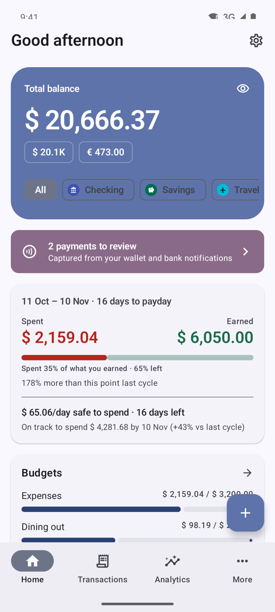
  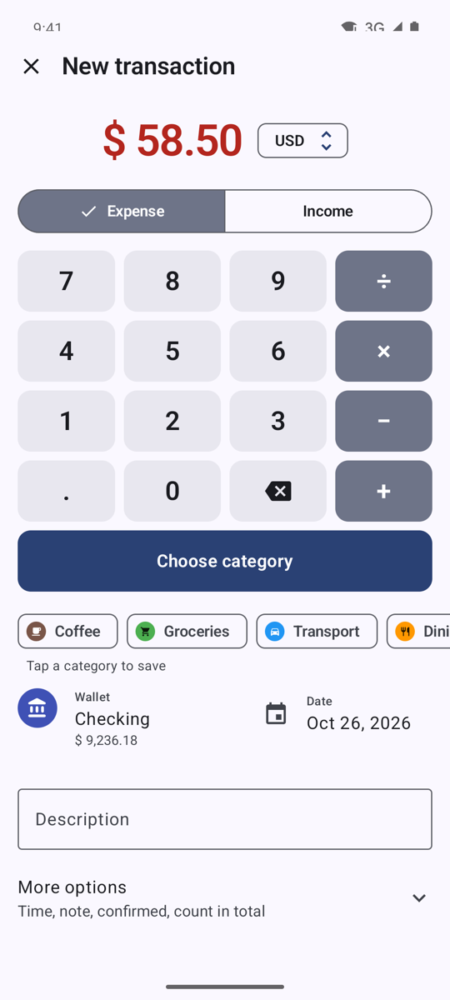
  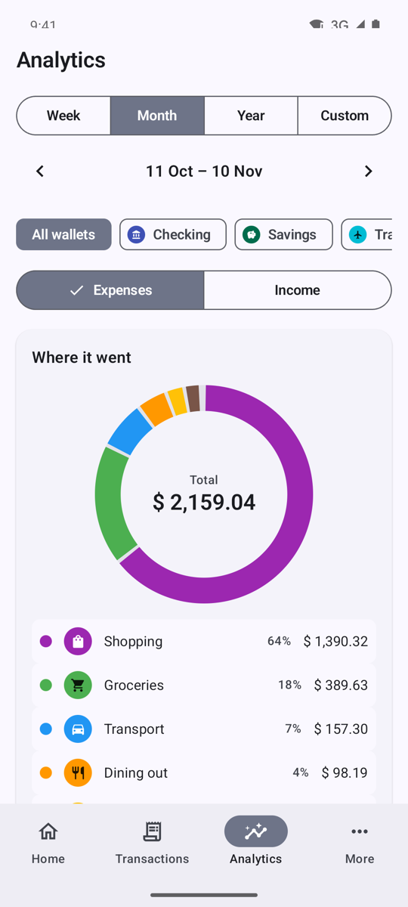
</p>

<p align="center"><sub>All screenshots use a made-up demo dataset.</sub></p>

## Contents

- [Features](#features)
- [Download](#download)
- [Build from source](#build-from-source)
- [Continuous integration](#continuous-integration)
- [Project layout](#project-layout)
- [Privacy](#privacy)
- [Credits and license](#credits-and-license)

## Features

### A home screen that answers "how am I doing?"

Your balance, the current pay cycle at a glance and what came in versus what went out. The month can
start on any day (your payday), and every comparison is like-for-like: on day 10 you are compared with
the first 10 days of the previous cycle, not the whole of it. A pacing line projects where you will
land and how much you can safely spend per day. Long-press the balance (or tap the eye) to hide every
amount in the app.

<p align="center">
  
  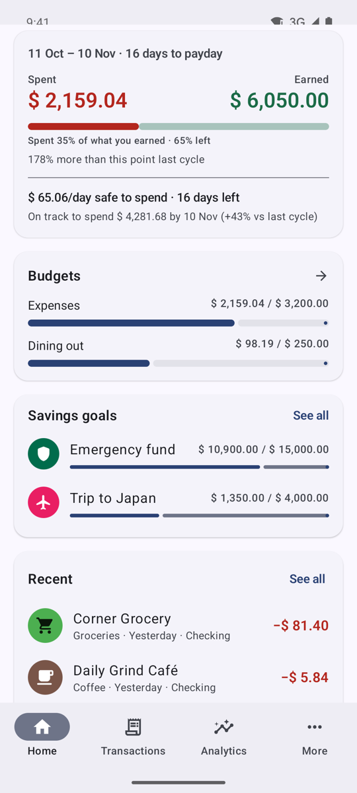
</p>

### Quick add

Type the amount on a keypad that sits right under it, then tap one of your most used categories: the
transaction is saved. Descriptions you have used before suggest their category, any currency can be
entered (it is converted into the wallet's currency with the latest rate, which you can override), and
the less common fields stay tucked under *More options*.

<p align="center">
  
</p>

### Transactions

Grouped by day with daily totals, filtered by wallet, searchable, and browsed cycle by cycle. Swipe a
row to delete it with undo. Transfers between your own wallets are never counted as spending or income.

<p align="center">
  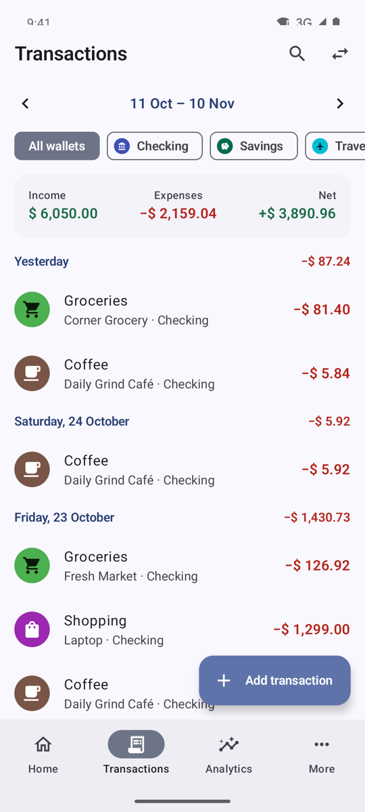
</p>

### Analytics

Where the money went, the daily trend, a like-for-like comparison with the previous period, net worth
over the last year, subscriptions and bills detected from repeating expenses, and your top merchants.

<p align="center">
  
  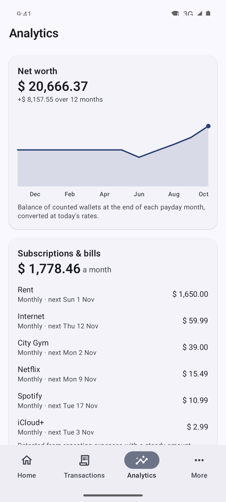
  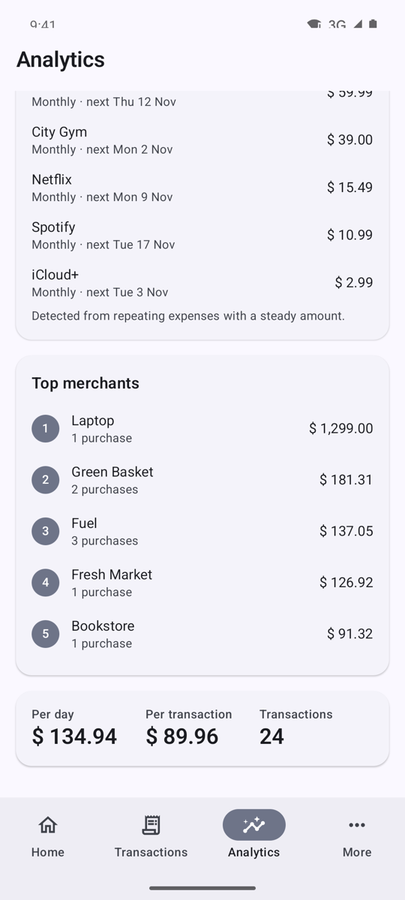
</p>

### Weekly and monthly reviews

A short story of the period that just ended: what you spent, the top categories, the biggest expense,
upcoming bills and a few insights that are only shown when they matter (an unusually large expense, a
category that moved a lot). A notification brings it to you when the week or the cycle ends.

<p align="center">
  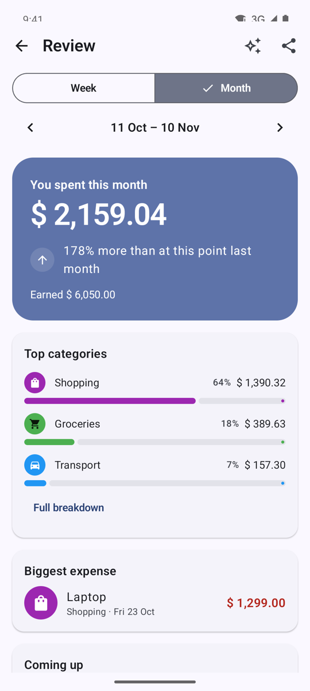
</p>

### Recaps

Big-number cards for a cycle or a whole year (total spent, top category, biggest day, savings rate),
each one shareable as an image.

<p align="center">
  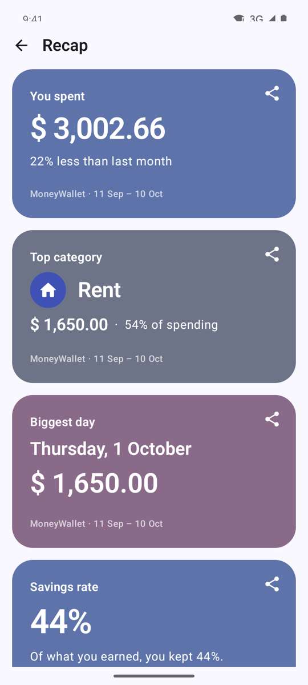
</p>

### Budgets

Overall or per-category limits for any period, across wallets in different currencies, with alerts at
80% and 100%.

<p align="center">
  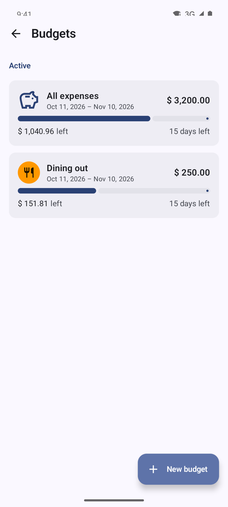
</p>

### Savings goals

Track a goal manually or link it to a wallet, and see how much to put aside each month to reach it by
the target date.

<p align="center">
  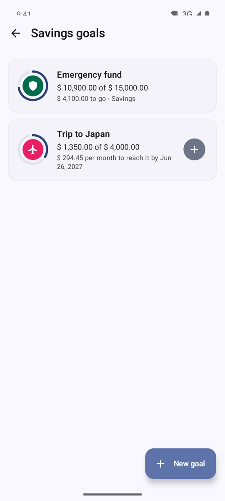
</p>

### Automatic payment capture

Payment notifications from wallet apps and bank SMS (English and Arabic) are read **on the device**
and turned into ready-to-add transactions. The transaction type in the message decides whether it is
money in or money out, the amount and counterparty come from the message's fields, and chats that
merely mention money are ignored. Teach it a message type it does not know with one tap, or import
bank SMS that arrived before capture was switched on.

<p align="center">
  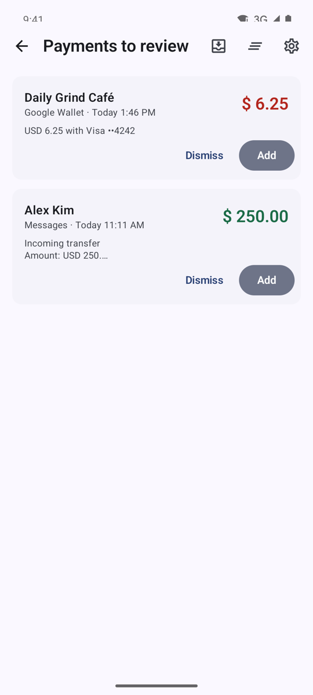
  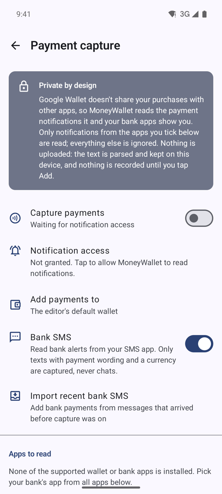
</p>

### Make it yours

129 Material symbols in any colour (plus the classic icon set and letter icons) for categories,
wallets and goals; light, dark and dynamic colour themes; home-screen widgets for the balance,
safe-to-spend and one-tap quick add.

<p align="center">
  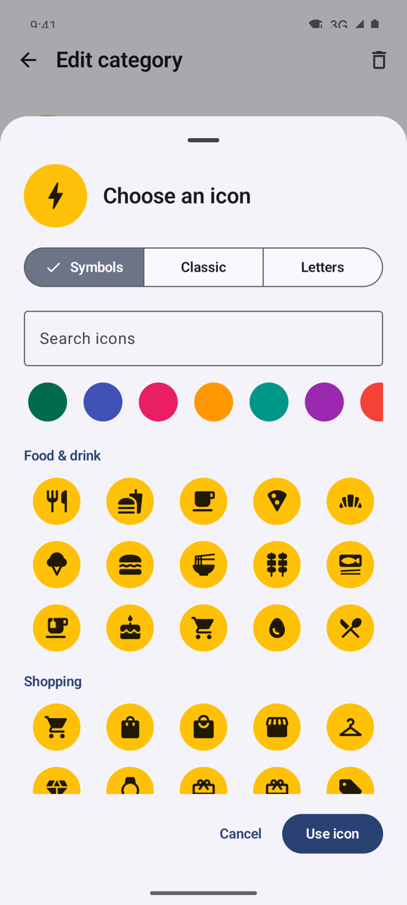
  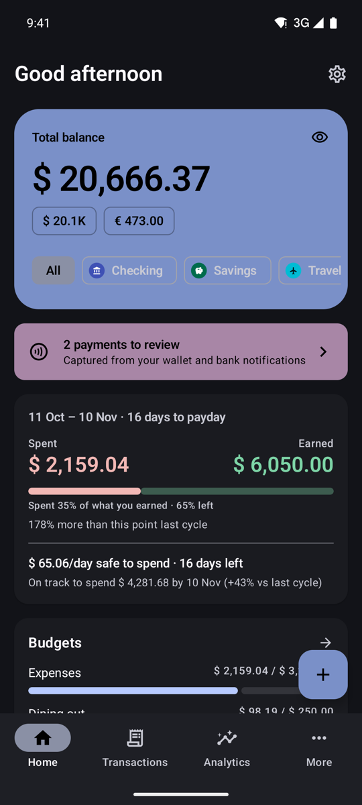
</p>

### And the essentials

- **Multi-currency** wallets with automatic exchange rates (no API key needed) and a global currency
  for totals.
- **Backups** in the original `.mwbx` format, compatible with the legacy app, plus **CSV**
  export and import (with column mapping and duplicate detection).
- **Biometric lock**, a hidden balance mode and no content in the recent-apps preview while locked.
- **No ads, no accounts, no tracking.**

## Download

- **Releases:** APKs are attached to each [release](https://github.com/aymanred121/moneywallet/releases).
- **Latest build:** every push builds an APK; open the most recent run under
  [Actions](https://github.com/aymanred121/moneywallet/actions/workflows/android.yml) and download the
  `moneywallet-next` artifact.

The app installs as `com.oriondev.moneywallet.next`, next to the original MoneyWallet if you have it.
Restore a `.mwbx` backup from the welcome screen to bring your data over.

## Build from source

Requirements: JDK 17 and the Android SDK (platform 35).

```bash
./gradlew :next:assembleDebug        # next/build/outputs/apk/debug/next-debug.apk
./gradlew :next:testDebugUnitTest    # unit, Robolectric, database and migration tests
```

Release builds are signed when `next/signing.properties` exists (it is git-ignored):

```properties
storeFile=signing/release.jks
storePassword=…
keyAlias=…
keyPassword=…
```

The original app still builds with `./gradlew :app:assembleFlossOsmDebug`.

## Continuous integration

[`.github/workflows/android.yml`](.github/workflows/android.yml) runs the unit tests and builds the APK
on every push and pull request, and attaches the APK to a GitHub release when a `v*` tag is pushed.

Builds are release-signed when these repository secrets exist (otherwise, for example on pull
requests from forks, a debug-signed APK is built). Release tags require them, must match `versionName`
in `next/build.gradle` (`v6.4.0` for `6.4.0`) and fail rather than publish a debug build. The
workflow verifies the signature and prints the certificate's SHA-256 in the run summary.

| Secret | Value |
| --- | --- |
| `KEYSTORE_BASE64` | `base64 -i release.jks` |
| `KEYSTORE_PASSWORD` | keystore password |
| `KEY_ALIAS` | key alias |
| `KEY_PASSWORD` | key password |

To release: bump `versionCode` / `versionName`, commit, then `git tag v<version>` and push the tag.

## Project layout

```
app/    the original MoneyWallet (Java, Android Views), kept for reference and parity
next/   the rewrite: Kotlin, Jetpack Compose, Material 3, Room, DataStore, WorkManager, Glance
  core/       money, dates, icons
  data/       Room database and migrations, backups, CSV, exchange rates, preferences
  domain/     periods, analytics, pacing, insights, subscriptions
  capture/    notification and SMS payment capture
  ui/         screens, components, theme and motion tokens
  widget/     home-screen widgets
```

## Privacy

Everything stays on your phone. The only network request is the daily download of public exchange
rates. Payment capture reads notifications only from the apps you choose, parses them on the device and
records nothing until you tap *Add*. Android's cloud backup only includes your data when the device
can encrypt it end to end.

## Credits and license

MoneyWallet was created by [AndreAle94](https://github.com/AndreAle94); please consider supporting the
original project. This fork is distributed under the same license, the
[GNU General Public License v3.0](LICENSE.md).
